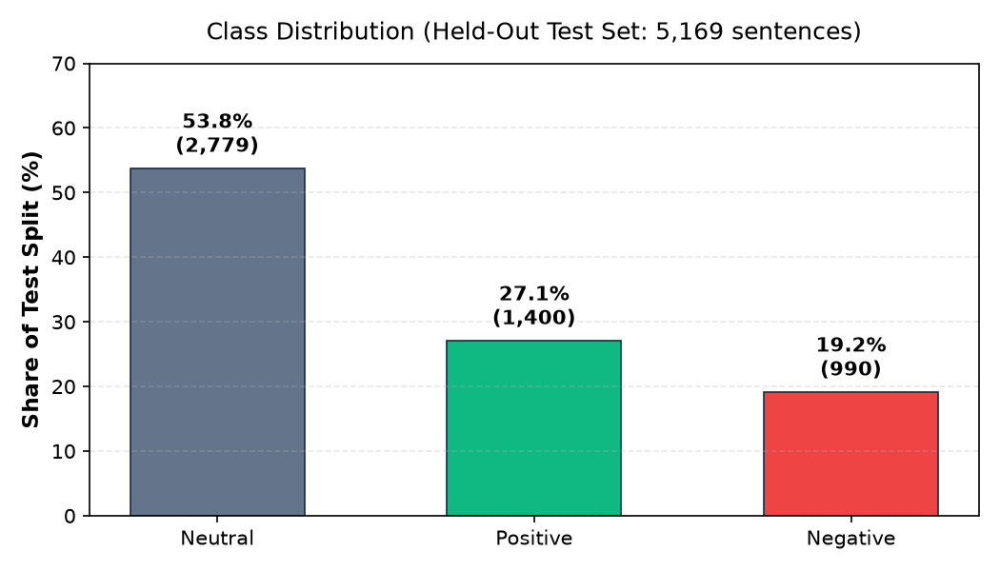
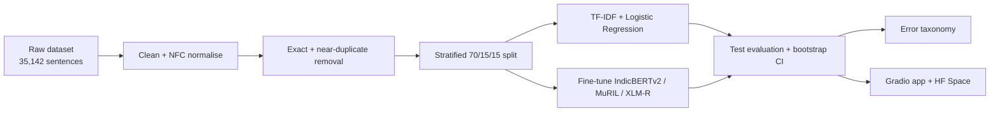
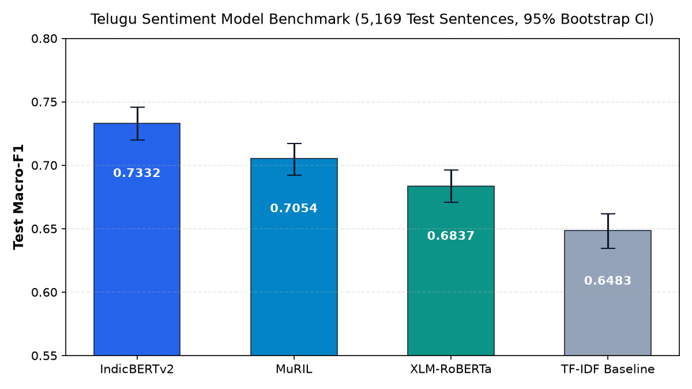
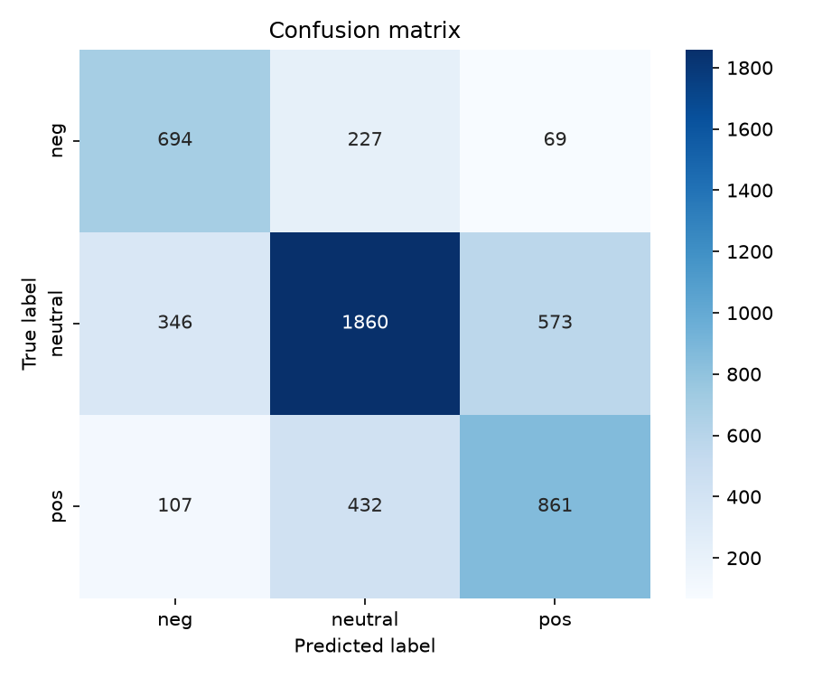
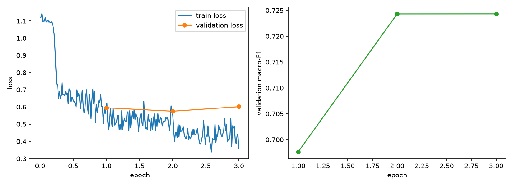
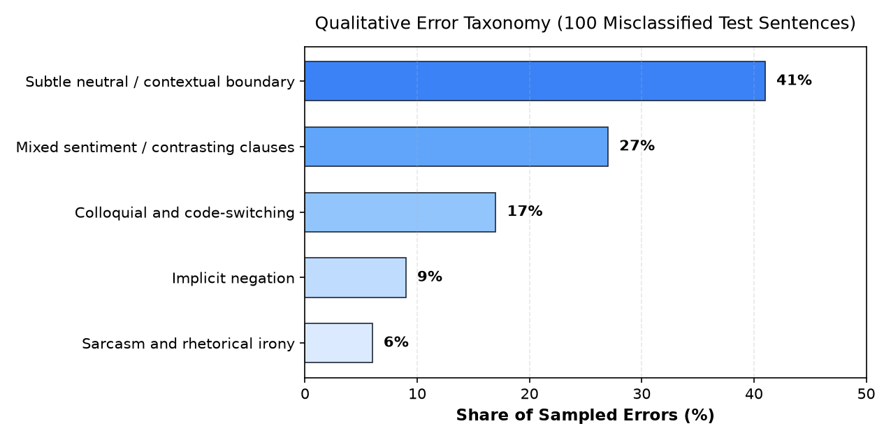

# Telugu Text Classifier (తెలుగు సెంటిమెంట్ వర్గీకరణ)


**Leak-free 3-class sentiment classification for native Telugu text.** A character n-gram TF-IDF baseline is benchmarked against fine-tuned IndicBERTv2, MuRIL and XLM-RoBERTa, with bootstrap significance tests, a manual error taxonomy, uncertainty thresholding and a Gradio app.

---

## Highlights

- **Best model: IndicBERTv2, macro-F1 0.7332** on 5,169 held-out sentences, versus 0.6483 for the TF-IDF baseline (+8.49 points, paired bootstrap p < 0.001).
- **Leak-free by design:** 143 exact and 538 near-duplicates removed *before* splitting; hyperparameters tuned on validation only.
- **Errors are analysed, not hidden:** 100 misclassified test sentences manually labelled into a 5-category taxonomy.
- **Usable:** Python inference API with a confidence threshold, an interactive Gradio demo and a Hugging Face Space deployment package.

---

## Problem and scope

3-class sentiment classification of native Telugu sentences: `pos` (సానుకూలం), `neutral` (తటస్థం), `neg` (ప్రతికూలం).

The data is naturally imbalanced, so **macro-F1 is the primary metric**: it weights every class equally and stops the majority neutral class from inflating the overall score.



---

## Dataset and leakage prevention

[`mounikaiiith/Telugu_Sentiment`](https://huggingface.co/datasets/mounikaiiith/Telugu_Sentiment): 35,142 Telugu sentences from news, films, cricket and politics, curated by IIIT Hyderabad (Marreddy et al., 2022, CC-BY-4.0).

1. **Cleaning:** Unicode NFC normalisation, whitespace and zero-width character standardisation.
2. **Deduplication before splitting:** 143 exact and 538 near-duplicates removed using character 5-gram shingling with Jaccard similarity ≥ 0.8, so no pair above that threshold spans train and test.
3. **Stratified 70 / 15 / 15 split** (seed 42): Train 24,123, Validation 5,169, Test 5,169. The test split is used only for final evaluation and error analysis.

Full statistics and vocabulary report: [`reports/data_report.md`](reports/data_report.md).

---

## Method



---

## Results

Evaluated on the held-out test split (5,169 sentences) across random seeds (42, 7, and 123).

| Model | Checkpoint | Test macro-F1 | 95% bootstrap CI | Test accuracy | Mean val macro-F1 | Δ vs baseline |
|---|---|:---:|:---:|:---:|:---:|:---:|
| **IndicBERTv2** | `ai4bharat/IndicBERTv2-MLM-only` | **0.7332** | [0.7197, 0.7459] | **0.7361** | **0.7264** | **+8.49 pts** |
| MuRIL | `google/muril-base-cased` | 0.7054 | [0.6921, 0.7171] | 0.7048 | 0.7060 | +5.71 pts |
| XLM-RoBERTa | `xlm-roberta-base` | 0.6837 | [0.6708, 0.6964] | 0.6821 | 0.6807 | +3.54 pts |
| TF-IDF baseline | char n-grams (2–5) + LogReg | 0.6483 | [0.6346, 0.6618] | 0.6607 | 0.6520 | — |

*Note on seeds:* Test numbers are measured on the held-out test set using the best-performing checkpoint across seeds 42, 7, and 123 (seed 123 for IndicBERTv2, seed 7 for MuRIL, seed 42 for XLM-RoBERTa); the mean validation Macro-F1 across all 3 seeds is reported alongside for complete transparency.



**Significance.** A paired bootstrap hypothesis test (1,000 resamples) of IndicBERTv2 against the TF-IDF baseline gives Δ = +0.0849 macro-F1, p < 0.001. The two 95% confidence intervals do not overlap ([0.7197, 0.7459] vs. [0.6346, 0.6618]), confirming that the transformer's superior performance is statistically significant.

<details>
<summary><b>Click to view Confusion Matrix and Training Loss Curves</b></summary>

| Baseline Confusion Matrix (Test Split) | IndicBERTv2 Fine-Tuning Loss Curves |
| :---: | :---: |
|  |  |

</details>

---

## Error analysis

About 26% of test sentences are still misclassified (IndicBERTv2 test accuracy 0.7361). 100 errors from the best-performing IndicBERTv2 model were sampled across classes, manually reviewed, and grouped into a 5-category linguistic taxonomy:



| Category | Share | What it looks like |
|---|:---:|---|
| Subtle neutral / contextual boundary | 41% | Factual reporting with a faint sentiment tone (e.g. administrative decisions) |
| Mixed sentiment / contrasting clauses | 27% | "సినిమాలో పాటలు బాగున్నాయి కానీ కథనం నెమ్మదిగా ఉంది" ("Songs great, story dragged") |
| Colloquial and code-switching | 17% | Telugu in Latin script, English loan words ("performance super ga undi") |
| Implicit negation | 9% | Negation without explicit లేదు / కాదు particles |
| Sarcasm and rhetorical irony | 6% | Surface positive words carrying negative intent |

Full analysis and Telugu examples: [`reports/error_analysis.md`](reports/error_analysis.md). Labelled sample: [`results/100_errors_labeled.csv`](results/100_errors_labeled.csv).

---

## Quick start

### 1. Setup Environment
```bash
git clone https://github.com/mahendravelagapudi099-wq/telugu-text-classifier.git
cd telugu-text-classifier
python -m venv .venv
```

```bash
# Windows (PowerShell)
.venv\Scripts\Activate.ps1
# Linux / macOS
source .venv/bin/activate

pip install -r requirements.txt
```

### 2. Get the Data and Models
`data/`, the baseline model and the transformer weights are not stored in git (large or regenerable):

```bash
python scripts/prepare_data.py     # downloads, cleans, deduplicates, splits into data/processed/
python scripts/train_baseline.py   # tunes and saves the TF-IDF baseline to results/baseline_model.joblib
```

**Transformer weights:**
- Fine-tune via Google Colab GPU: open and run [`notebooks/train_colab.ipynb`](notebooks/train_colab.ipynb).
- Or run local training on CPU/CUDA: `python scripts/train_transformer.py --model ai4bharat/IndicBERTv2-MLM-only --epochs 3`.
- `src/predict.py` automatically detects checkpoints in `outputs/` or falls back to the baseline pipeline.

### 3. Run the Demo and Tests

```bash
python app.py        # opens interactive Gradio app at http://127.0.0.1:7860
pytest tests/        # runs full 8-module test suite
```

### 4. Python API

```python
from src.predict import TeluguSentimentPredictor

# Predict with uncertainty confidence threshold (default: 0.50)
predictor = TeluguSentimentPredictor(threshold=0.50)
print(predictor.predict("ఈ సినిమా చాలా బాగుంది!"))
# {
#   'text': 'ఈ సినిమా చాలా బాగుంది!',
#   'label': 'pos',
#   'confidence': 0.9356,
#   'is_uncertain': False,
#   'probabilities': {'neg': 0.0101, 'neutral': 0.0543, 'pos': 0.9356},
#   'model': 'IndicBERTv2-MLM-only_seed42'
# }

# Batch prediction
predictor.predict([
    "ఈ ఉత్పత్తి చాలా బాగుంది!",
    "నాకు ఏమీ అర్థం కాలేదు",
    "సరే చూద్దాం"
])
```

---

## Hugging Face deployment

See [`MODEL_CARD.md`](MODEL_CARD.md) for full architecture parameters, data documentation and ethical limitations. The Space package is located in [`deployment/hf_space/`](deployment/hf_space/).

```bash
# Dry-run validation (no token needed)
python scripts/push_to_hub.py --dry-run --space-repo username/telugu-sentiment-demo

# Live upload
export HF_TOKEN="hf_your_token_here"        # Windows PowerShell: $env:HF_TOKEN="hf_your_token_here"
python scripts/push_to_hub.py --space-repo username/telugu-sentiment-demo
```

---

## Limitations

- **Class imbalance:** Neutral is 53.8% of the data, and "subtle neutral" is also the largest error category (41%).
- **Domain coverage:** Built on four domains (news, films, cricket, politics). Performance on other domains, such as medical, legal, or informal Twitter/X text, is not measured.
- **Code-switching & Romanized Telugu:** Telugu written in Latin script with transliterated slang remains a known challenge (17% of reviewed errors).
- **Test split dual use:** The test split was evaluated for final metrics and inspected for error analysis; subsequent model iterations should be evaluated on a fresh test set.

---

## Repository structure

```
├── configs/config.yaml        # seeds, split ratios, dedup parameters
├── src/                       # data cleaning/dedup/split, baseline, evaluation, predict, utils
├── scripts/                   # data prep, training, evaluation, significance tests, hub upload,
│                              # make_readme_figures.py
├── notebooks/train_colab.ipynb
├── deployment/hf_space/       # standalone Gradio app for Hugging Face Spaces
├── reports/                   # data_report.md, error_analysis.md
├── results/                   # metrics, predictions, labelled errors, plots
├── assets/                    # README figures (class_distribution, model_comparison, error_taxonomy)
├── tests/                     # 8 test modules verifying end-to-end functionality
├── app.py                     # Interactive Gradio demo app
├── MODEL_CARD.md              # Hugging Face Model Card
├── LICENSE                    # MIT License
└── progress.md                # Milestone log
```

Not in git (regenerable): `data/`, `outputs/` (fine-tuned weights), `results/baseline_model.joblib`.

---

## Links and contact

- Model card: [`MODEL_CARD.md`](MODEL_CARD.md)
- Data Report: [`reports/data_report.md`](reports/data_report.md)
- Error Analysis Report: [`reports/error_analysis.md`](reports/error_analysis.md)
- GitHub Repository: [https://github.com/mahendravelagapudi099-wq/telugu-text-classifier](https://github.com/mahendravelagapudi099-wq/telugu-text-classifier)

---

## Citation and credits

- **Dataset:** Marreddy et al., *"Clickbait Detection and Sentiment Analysis in Telugu"*, TALLIP 2022 (IIIT Hyderabad).
- **IndicBERT v2:** AI4Bharat, *"IndicBERT v2: Towards High-Quality Pre-trained Language Models for Indic Languages"*, arXiv:2312.05445.
- **MuRIL:** Google Research.
- **XLM-RoBERTa:** Facebook AI (Conneau et al., 2020).
